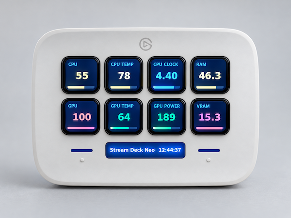

# Rivulet Deck



A live system dashboard on an Elgato Stream Deck.

**This is a demonstration project.** Everything in this repository — the code, the tests, the
configuration and the documentation — was written entirely by the model
**`qwen3.8-flash-next-iq3_xxs`**, running locally on the same machine the Stream Deck is plugged
into. No external model provider or hosted inference was involved at any point.

The target device is the **Stream Deck Neo**
(8 keys at 96×96, a 248×58 strip display): CPU %, CPU temperature and clock, RAM, GPU load and
temperature, GPU power, VRAM. Key layout, thresholds, refresh interval, trend window and strip
text are all described in [`rivulet.toml`](rivulet.toml) — changing the dashboard does not
require editing Python.

## What a key shows

Every key carries its label, the current value, and a sparkline along the bottom that shows how
that value moved over the last `trend_samples` readings — 30 by default, which is a minute at the
2 s refresh. The graph is stretched to its own minimum and maximum rather than to the key's
ceiling, so a value that only drifted between 45 % and 55 % is as readable as one that swung from
0 % to 100 %; the colour still follows the slot's thresholds, and the newest reading is always on
the right edge.

## Running it

```bash
uv sync                 # create .venv and install dependencies
uv run rivulet-deck     # start the dashboard (Ctrl+C or SIGTERM blanks the keys)
```

`config.load()` reads `rivulet.toml` relative to the current directory, so run the app from the
repository root.

Both Ctrl+C (SIGINT) and a plain `kill` (SIGTERM) are handled: the keys are blanked and the deck
is closed before the process exits, so an interrupted run never leaves the last frame lit.

## Tests and lint

```bash
uv run pytest           # 96 tests, headless: they touch neither the deck nor real telemetry
uv run ruff check .     # ruff, running on its own default rules
```

## License

MIT — see [LICENSE](LICENSE).
